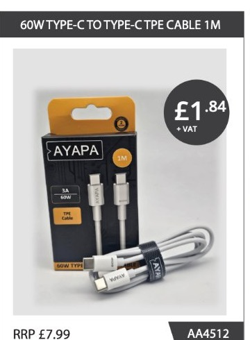

# AYAPA Wholesale Mobile Accessories & Repairs B2B E-Commerce Platform

A high-performance, mobile-first wholesale ordering portal specifically engineered for **retail shop owners and repair stores** (optimized for 90%+ mobile traffic).

🌐 **Live Deployment:** **[https://monk-24.github.io/Ayapa/](https://monk-24.github.io/Ayapa/)**  
🔐 **Admin Portal PIN:** **`971400`**  
📲 **AYAPA EPOS WhatsApp:** **`+44 7767 935049`**



---

## 🌟 Key Features

### 1. Mobile-First Wholesale Ergonomics (90% Mobile Users)
- **Fast 2-Column Touch Grid**: Displays crisp product packaging photos, SKU badges, quality tags, and live stock status.
- **B2B Margin Economics**:
  - Wholesale Unit Price (Excl. VAT) & Price (Inc. VAT)
  - Recommended Retail Price (**RRP**)
  - Instant **Shop Profit & Margin % badge** (e.g., *Buy at £1.84, Sell at £7.99 → +£5.78 Profit / 72% Margin*).
- **Wholesale Quick-Pack Adders**: `+1`, `+5`, `+10` buttons for instant wholesale batch ordering.
- **Real-Time Cart Synchronization**: Steppers and inputs dynamically update unit counts, subtotal, 20% VAT, total inc VAT, and retail margin return in real-time.
- **Sticky Bottom Floating Cart**: Always shows total units, total payable, and calculated potential shop resale return.
- **Bottom Navigation Bar**: Native app-like tabs for **Shop**, **Order Cart**, **My Orders**, and **Staff Manager**.
- **Interactive Lightbox & Profit Calculator**: Tap any product to view high-resolution imagery, full technical specifications (power, connectors, length, materials), and simulate profit on custom order quantities (10, 25, 50, 100 units).

---

### 2. Multi-Channel Order & Invoice Dispatch
- **1-Click WhatsApp Order to AYAPA EPOS (+44 7767 935049)**:
  - Formats the complete itemized purchase order (SKU, product descriptions, quantities, unit prices, subtotal, 20% UK VAT, total payable, client store details, and delivery notes).
- **1-Click Customer Invoice Copy to WhatsApp**:
  - Customer can send the complete invoice slip directly to their own WhatsApp mobile number for their records.
- **Automated Customer Email Invoice**:
  - Opens customer's email client pre-filled with subject and a formatted pro-forma invoice breakdown with BACS transfer details.
- **A4 Pro-Forma Invoice & PDF Print**:
  - Clean, official printable invoice with AYAPA company details, Barclays Bank payment details, itemized table, and tax breakdown.

---

### 3. Admin & Inventory Management (PIN: 971400)
- **Protected by Staff PIN (`971400`)**: Restricted to AYAPA staff and management.
- **1-Click Stock Status Toggle**:
  - Instant toggle button (`In Stock` / `Out of Stock`) on every product row.
  - Filter catalog by *All*, *In Stock*, or *Out of Stock*.
  - When marked Out of Stock, storefront immediately reflects the badge and disables addition to cart.
- **Product & Image Manager ("Where image you can add")**:
  - Drag-and-drop or tap to upload product packaging photos from file or smartphone camera.
  - Edit existing product prices (Ex VAT, Inc VAT, RRP), names, and quality badges.
  - Add new products with live preview.
- **CSV & JSON Import/Export**:
  - Bulk update catalog pricing and stock from CSV.
  - Export incoming orders and products for accounting and stocktaking.

---

### 2. Complete 92-Product Wholesale Catalog Included
Extracted directly from the official AYAPA price sheet and catalog scans:
- **Cables (Type-C, Lightning 8-Pin, Audio, HDMI, 90° Gaming, 10-Packs)**
- **Chargers & Power Adapters (GaN 20W, Dual USB 12W/20W/30W, UK 3-Pin Tourist)**
- **Car Accessories (Fast PD Car Chargers, Magnetic Z-Fold Holders, Suction Mounts)**
- **Earphones & TWS (Type-C, Lightning, 3.5mm, 50H Noise-Cancelling TWS)**
- **iPhone LCD Screens (OLED Soft/Hard, 5G to XS Max, Tested Touch Assemblies)**
- **MOXOM High-Capacity iPhone Batteries (1-Year Warranty, TI Protection Chip)**
- **Screen Protectors (5D Tempered Glass Full Cover/Full Glue, MacBook)**
- **Display Stands & Bumper Packs (£500 199-Item Shop Starter Pack)**
- **Power Banks, Cases & Gadgets**

---

### 3. Streamlined Checkout & Direct Order Submission
No friction, no upfront credit card required:
- Collects:
  - **Shop / Business Name**
  - **Contact Person Name**
  - **Mobile Phone Number** (for WhatsApp & SMS confirmation)
  - **Email Address** (for invoice delivery)
  - **Shop Delivery Address, City & Postcode**
  - **Delivery / Order Notes**
- **1-Click WhatsApp Order Submission**:
  - Automatically formats the full itemized purchase order with quantities, SKU codes, subtotal, 20% UK VAT, total payable, and shop delivery details.
  - Opens WhatsApp directly to send the order to the AYAPA sales team in 1 click!
- **Pro-Forma Invoice Generation & PDF Print**:
  - Instant pro-forma invoice complete with Order ID, customer details, bank BACS transfer details, itemized table, and VAT breakdown.
- **Local Order History**: Saves past orders in the shop owner's browser for 1-click re-ordering.

---

### 4. Admin & Image Management ("Where image you can add")
- Built-in **Product & Image Manager**:
  - **Drag-and-Drop Image Uploader**: Tap or drop any image (supports camera uploads from smartphones, JPG, PNG, WebP).
  - Automatically converts uploaded files into persistent high-speed Data URLs saved directly to browser storage.
  - Add new SKU codes, names, categories, wholesale prices, and RRP.
  - Toggle stock status (**In Stock** vs. **Out of Stock**).
  - **Export Catalog**: 1-click export of catalog as JSON for backup.

---

## 🚀 Quick Start / Running Locally

The application is completely self-contained with **zero external dependencies**:

```bash
# Start the local server
node server.js
```

Open your browser at:
👉 **[http://localhost:3000](http://localhost:3000)**

---

## 📂 Project Structure

```
├── index.html              # Mobile-first responsive web portal
├── server.js               # Zero-dependency Node.js HTTP server
├── css/
│   └── style.css           # Ayapa Dark & Gold design system & responsive styling
├── js/
│   ├── app.js              # UI controller, modals, search, WhatsApp & invoice generator
│   ├── store.js            # Reactive state management (cart, orders, custom products)
│   └── products-data.js    # 92 wholesale products dataset
├── products/               # 55 cropped product images & category visuals
└── public/                 # Original cropped assets & products.json
```
